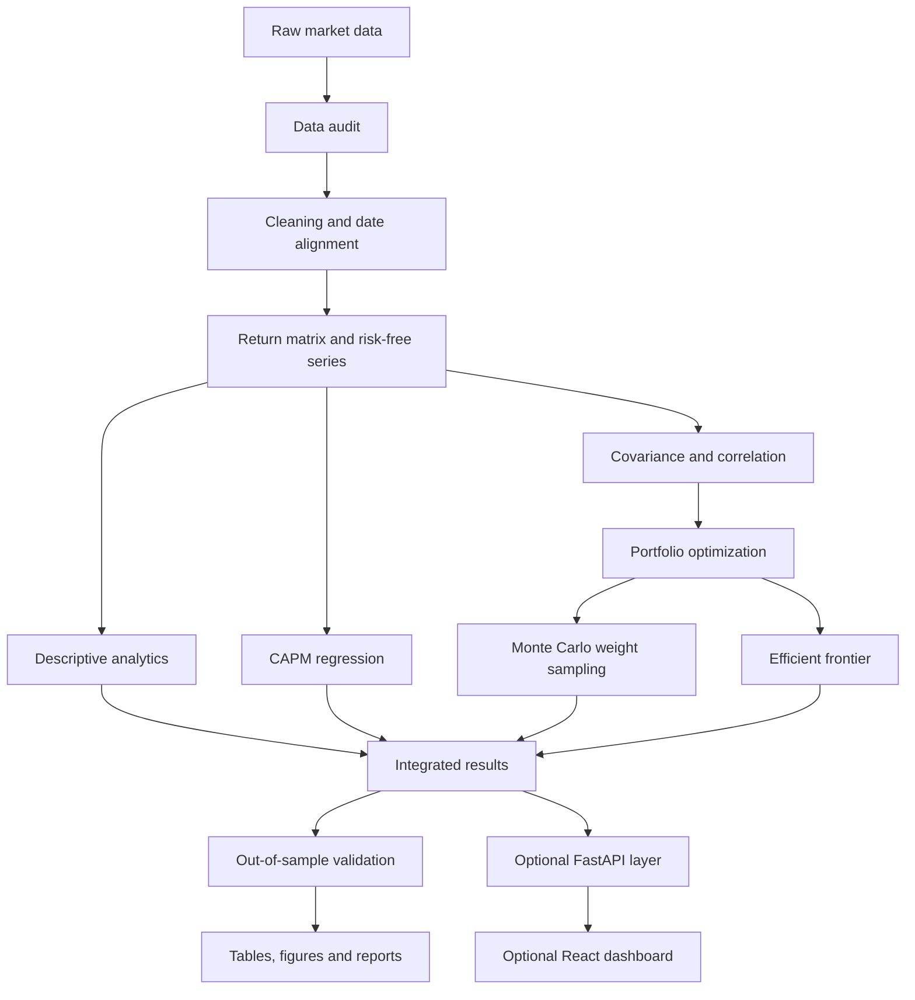

# System Architecture Reference

## 1. Design principles

The architecture follows the separation used in the team's Formula 1 project:

1. **Core logic is independent:** CAPM, return analytics and portfolio optimization live in `src/`, not in API routes or frontend components.
2. **Shared data preparation:** all models consume the same documented return matrix and metadata.
3. **Separate analytical responsibilities:** descriptive analytics, CAPM, portfolio optimization, simulation and validation have distinct modules.
4. **Reproducible integration:** one pipeline orchestrates the analysis and returns structured results.
5. **Validation is a first-class module:** data checks, mathematical constraints and out-of-sample evaluation are explicit.
6. **Delivery layers are optional:** the Python core must work without a frontend.
7. **Strict contracts:** use typed Python data models; if a frontend is built, mirror public response types in TypeScript.

## 2. High-level flow

## 3. Module responsibilities

### `src/portfolio_optimizer/common/`
Shared configuration, date/frequency conventions, exceptions, logging and typed contracts.

### `src/portfolio_optimizer/data/`
- `providers.py`: provider-facing retrieval adapters; provider choice remains configurable.
- `loader.py`: load raw files and metadata.
- `audit.py`: duplicates, missingness, nonpositive prices, date coverage and symbol checks.
- `preprocessing.py`: date alignment and documented cleaning.
- `returns.py`: simple/log return calculation and annualization helpers.

### `src/portfolio_optimizer/analytics/`
- `descriptive.py`: stock-level descriptive statistics.
- `risk_metrics.py`: volatility, drawdown and Sharpe/other selected metrics.
- `dependence.py`: correlation and covariance matrices.

### `src/portfolio_optimizer/capm/`
- `regression.py`: excess-return regression.
- `results.py`: beta, alpha, R-squared, uncertainty and diagnostics.
- `service.py`: orchestrates CAPM analysis across the universe.

### `src/portfolio_optimizer/portfolio/`
- `parameters.py`: expected-return vector, covariance matrix and constraints.
- `objectives.py`: minimum variance and maximum Sharpe objective definitions.
- `solver.py`: numerical optimization adapter and status handling.
- `frontier.py`: target-return constrained optimization and frontier generation.
- `weights.py`: portfolio-weight validation and concentration metrics.
- `benchmarks.py`: equal-weight and market benchmark comparisons.

### `src/portfolio_optimizer/simulation/`
- `monte_carlo_weights.py`: reproducible sampling of feasible weights.
- `portfolio_metrics.py`: return, risk and Sharpe calculations for candidate weights.
- Do not conflate weight sampling with future-return-path simulation.

### `src/portfolio_optimizer/validation/`
- `data_checks.py`: data quality invariants.
- `model_checks.py`: regression and optimizer correctness checks.
- `backtest.py`: chronological holdout/walk-forward evaluation.
- `reporting.py`: evaluation tables and plots.

### `src/portfolio_optimizer/integration/`
- `pipeline.py`: orchestrates the common analysis workflow.
- `comparison.py`: compares portfolios using identical conventions and evaluation dates.

### `scripts/`
Command-line entry points for data audit, dataset build, analysis and validation. Scripts call core services; they should not duplicate formulas.

### `notebooks/`
Exploratory work and one-off experiments. Stable production calculations should be moved into tested modules.

### `backend/` and `frontend/`
Optional presentation layers. Backend routes validate requests and call core services. The frontend renders results and collects parameters; it does not implement CAPM or optimization formulas.

## 4. Data contracts

The canonical processed data should include, at minimum:
- trading date;
- one adjusted/total-return price series per selected stock, or a documented return series;
- benchmark series;
- risk-free rate with its quote convention and effective dates;
- metadata for symbol, company, sector, exchange, currency and data source.

The analytical pipeline should produce typed outputs for:
- data audit;
- stock statistics;
- CAPM regression results;
- correlation/covariance;
- portfolio weights and metrics;
- efficient-frontier points;
- out-of-sample evaluation.

## 5. Dependency direction

Allowed:
- `data` → `common`
- `analytics` → `common`, `data`
- `capm` → `common`, `data`
- `portfolio` → `common`, `analytics`
- `simulation` → `common`, `portfolio`
- `validation` → `common`, `analytics`, `capm`, `portfolio`
- `integration` → the public services of these modules
- API → integration services
- frontend → API contracts

Disallowed:
- frontend importing Python core code;
- API routes containing financial formulas;
- core analytics depending on FastAPI or React;
- notebooks becoming the only location of essential calculations.

## 6. Planned repository tree

See the root `README.md` for the full starter tree. Create files only when their responsibilities are understood; do not create dozens of empty abstractions just to make the tree look large.
